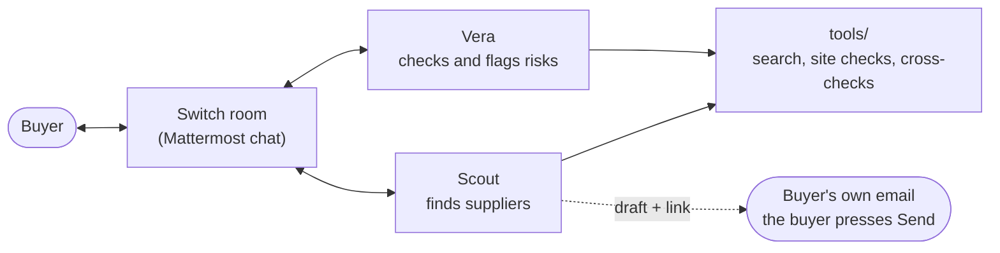

# How ProcureMate works

## The flow



The agents talk to the buyer and to each other only in the room. The tools do the searching and checking. Nothing is sent by the agents: the buyer opens the quote link and sends the email.

## Example conversation

> **Illustrative example with demo data; not a real run.** The businesses are made-up (`.example` domains) and the numbers come from the repo's demo data. Real runs look similar but use real results.

**Buyer:** @scout 20 office chairs delivered to Abuja, budget ₦2,000,000, within 7 days

**Scout:**

**TASK STATE**

- **Product:** office chairs
- **Quantity:** 20
- **Location:** Abuja
- **Budget:** ₦2,000,000
- **Deadline:** within 7 days
- **Target:** not given
- **Must-haves:** none given
- **Exclusions:** none
- **Decisions:** none yet

Searching now. This can take 5 to 10 minutes; I'll update you every couple of minutes.

**Scout** (a little later): Still checking, 6 of 10 done, about 2 minutes left.

**Scout:**

@vera HANDOFF: 6 to check

**Found**

- 10 relevant suppliers, 7 chair sellers
- Based in Abuja: 5 (1 fit unclear) / other regions: 0 / serve Abuja: 1
- Overseas excluded: 0, leads only: 4

**Check these**

- garki-office-furniture.example (based Abuja; says it delivers; from ₦45,000, visitor chairs)
- kubwa-seats.example (based Abuja; says it delivers; from ₦38,000, office chairs)
- lagos-seating.example (no address; says it delivers; from ₦52,000, task chairs)
- wuse-seating-gallery.example (based Abuja; says it delivers; no price)
- kano-office-supplies.example (no address; no delivery info; no price)
- abuja-seating.example (based Abuja; says it delivers; from ₦185,000, ergonomic mesh chairs)

**Main gaps**

- Most sites show no email.
- Two sites show no address.

Full list and evidence in the thread.

**Vera:**

Review of the 6 (CAC not checked):

Based in Abuja: kubwa-seats.example (from ₦38,000, says it delivers), garki-office-furniture.example (from ₦45,000, says it delivers)

**Quote first**

- kubwa-seats.example (second source agrees; ₦38,000 listed, within the ₦100,000 share)
- garki-office-furniture.example (name and address match across pages; ₦45,000 listed, within the share)

**Worth asking questions** (the question in brackets)

- wuse-seating-gallery.example (price?)

**Only their own site, no second source**

- lagos-seating.example

**Couldn't confirm** (reason in brackets)

- kano-office-supplies.example (not enough evidence)

**Biggest risk:** most suppliers show only their own site as evidence.

**Scout:** (after Vera's review, unasked)

1. **kubwa-seats.example** (Abuja; delivery to Abuja: says it delivers)
   Price: from ₦38,000 listed per chair (office chairs), within the ₦100,000 per-chair share, including delivery
   Contact: +234 803 555 0106, no email found; call or WhatsApp +234 803 555 0106
   Vera: second source agrees on name and phone.

2. **garki-office-furniture.example** (Abuja; delivery to Abuja: says it delivers)
   Price: from ₦45,000 listed per chair (visitor chairs), within the ₦100,000 per-chair share, including delivery
   Contact: +234 803 555 0102, no email found; call or WhatsApp +234 803 555 0102
   Vera: name and address match across its pages.

Want quote drafts for any of these?

**Buyer:** shortlist 1 and 2, then go with 1

**Scout:**

**DECISIONS**

- **Shortlisted:** kubwa-seats.example, garki-office-furniture.example
- **Quote requests to prepare:** kubwa-seats.example (nothing sent)

**Scout:** (after the buyer's yes. The demo data has no email addresses, so the address below is invented for this illustration.)

**kubwa-seats.example**: sales@kubwa-seats.example (Address from: contact page). **Open in my mail app** | **Open in Gmail**

Click to open your email, check it, and press Send yourself.

The full text, once, for copying (same text for all; change the greeting if you like):

```text
Hello, we need 20 office chairs delivered to Abuja within 7 days. Please send the unit price, VAT and fees, delivery cost, lead time and your company registration number.
```

Nothing has been sent. The two links open the buyer's own email with the recipient, subject and text filled in. The buyer presses Send. The same text can be pasted into WhatsApp or a supplier's contact form.
